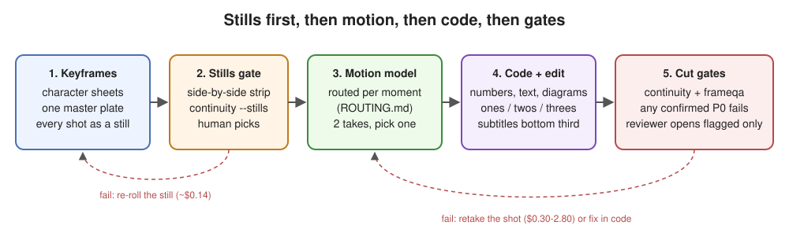

# animation-model-router

A field guide, plus small tools, for **routing AI animation work to the right model** for each moment of a shot.
It comes from a studio making short cartoon videos: flat 2D characters, often in photoreal sets, mostly vertical
9:16, lots of food and talking. The numbers come from blind, same-input bake-offs run in **2026-10**.

Models change fast. The method lasts longer than the winners, so the repo includes the tools to re-run the tests.



## The core principle

1. **Consistent keyframes first.** Make every shot of a scene as a still, from one master plate and locked character
   sheets, and check the stills together. Most continuity failures (a sidekick who vanishes, arms that change between
   shots) are baked into the start frames before any motion model runs. A still re-roll costs about $0.14; a video
   re-roll costs $0.30-2.80.
2. **Then the right motion model per moment.** No model wins everything. The house default lost badly on props, real
   plates and glove-plus-food, and won on prop-light acting. Route by moment.
3. **Then code for diagrams and text.** Never ask a video model to draw a number, a word, a label or a chart. A code
   layer is exact, free, re-timeable and never drifts. Timing (ones, twos and threes) is applied in the edit too.
4. **Then QA gates.** Cheap per-frame screens (a continuity checker, a "broken frame" checker, a voice-over sync
   check and a fast judge tuned to your own calls) gate every cut; any confirmed P0 fails it. The expensive reviewer
   opens only flagged frames, and blind fresh-context critics rank takes. A human picks.
5. **What's on screen matches what's said.** Every line lands on the picture it describes, poses included, and held
   characters stay alive. See [LESSONS.md](LESSONS.md).

## Quick routing table (2026-10)

| Moment | Use | Instead of |
|---|---|---|
| Scene keyframes | **GPT Image 2.5 high** + 5 refs (master, empty plate, 2 sheets, pose card) | Nano Banana Pro; "harmonize" passes |
| Same-camera coverage stills | Nano Banana 2.1 (most stable set; fakes new angles) | |
| New on-model pose still | **GPT Image 2 high** | |
| Packaging with exact text | **Nano Banana Pro**, every word listed verbatim | FLUX.2 / Kontext |
| Two-shot lip-sync to your VO | **MiniMax H3 Max ref-to-video, hosted** ($0.05/s); fallback Seedance 2.0 ref + audio | self-hosted H3 weights (licence) |
| Full-body action with a prop | **Seedance 2.5** or **Kling 4.0 / Wan 3.0** (by character) | Hailuo (props float), Veo 3.1 Fast |
| Expressive close-up | **Kling 4.0** | |
| Cartoon hand/glove on real food | **Wan 3.0** | Hailuo, Veo |
| Food hero | **Wan 3.0** (thick liquids), **Hailuo 2.3** (pours, peels) | |
| Character on a real plate | code composite start frame + **Kling 4.0** | |
| Cartoon replacing a person in footage | **Wan 3.0 ref-to-video** + proportion-lock prompt | whole-frame "omni edit" models |
| Prop-light cartoon acting | **Hailuo 2.3**, finished on twos | |
| Numbers, words, labels, diagrams, subtitles | **code** | any video model |
| Named positions (grips, leg long, fold) | **one keyframe per position** + image-to-video, limbs locked | a motion-copy swap (flattens poses) |
| Held stretch, listening or talking character | **living hold:** lip-sync / ref-to-video from the held still, breathing and blinks | a frozen frame bobbed in code; ping-pong |
| Breathing guide | **code** (`tools/breathpacer/`) | any video model |
| Frame QA at scale | **a fast judge** (atomic yes/no, maths in code) + escalation | a big model on every frame |

Full detail per moment (settings, prompt templates, reference recipes, cost per second, failure modes):
**[ROUTING.md](ROUTING.md)**. How to call each model on fal or Hugging Face: **[SETUP.md](SETUP.md)**.

## The guides

| File | What |
|---|---|
| [ROUTING.md](ROUTING.md) | A model per moment: winner, runner-up, settings, prompt, refs, cost, failure modes |
| [KEYFRAMES.md](KEYFRAMES.md) | Master-plate method, character sheets, the edit prompt, "prompt nouns trigger anatomy", the keyframe gate |
| [TIMING.md](TIMING.md) | Ones, twos and threes per action and layer, applied in the edit |
| [QA.md](QA.md) | Continuity checker, frameqa, blind critics, the gate rules, delivery rules |
| [BAKEOFF.md](BAKEOFF.md) | Run your own fair bake-off: principles, moments, critic prompt, log templates |
| [PERSONAL-USE.md](PERSONAL-USE.md) | Private, non-commercial route: animate from **any** reference image (permissive hosted plus open-weight models), voices without cloning real people |
| [LESSONS.md](LESSONS.md) | Production lessons: on screen matches what's said, poses match, proportion stretch in swaps, living holds, stretches hold, breath pacer, a fast judge model, paid-API locks and budgets |
| [SETUP.md](SETUP.md) | fal and Hugging Face routes: keys, the queue API, model ids per job with list prices, Spaces, Inference Providers, Endpoints and Jobs, licences for self-hosting, which route when |

## The tools

All Python 3.10+, ffmpeg/ffprobe on PATH. `pip install -r requirements.txt`.

| Tool | Does | Needs |
|---|---|---|
| `tools/continuity/continuity.py` | Story continuity across frames and shots against a per-scene bible; `--stills` is the keyframe gate | a screen model key (`TYPESAFE_API_KEY`, or `--screen fal/gemini/ollama`); `FAL_KEY` or local Ollama to confirm |
| `tools/frameqa/frameqa.py` | Broken-frame QA: cuts, black, frozen, flicker, loudness, safe-area text (OCR), glitches | same keys, or `--backend none` for code checks only |
| `tools/timing/onestwos.py` | Re-time smooth AI video onto ones/twos/threes per segment, audio untouched | nothing (local) |
| `tools/bakeoff/bake.py` | Resumable, cost-capped fal bake-off runner with a ledger | `FAL_KEY` |
| `tools/bakeoff/sheet.py` | Contact sheets, keyframe strips, dense lip-sync sheets | nothing |
| `tools/bakeoff/critic_pack.py` / `tally.py` | Anonymise + shuffle takes per blind critic; decode votes into a table | nothing |
| `tools/vosync/vosync.py` | Does the picture match the voice-over line, at that moment? Strips per line, timing checks, optional vision yes/no | nothing (timing); `FAL_KEY` or an OpenAI-compatible key for the vision pass |
| `tools/judge/judge.py` | Fast judge: atomic questions per frame, verdicts in code, a logistic layer fitted to your labels, escalation | `TYPESAFE_API_KEY`, or `--backend fal/openai/ollama` |
| `tools/breathpacer/pacer.py` / `hero.py` | Breath pacer overlay (small circle) and the big guided-breathing panel | nothing (local) |
| `tools/fal_run.py` | One fal queue call: upload, submit, poll, download; daily cap, ledger, stops on a lock; `--dry-run` | `FAL_KEY` |
| `tools/hf_run.py` | Call a Hugging Face Space (Gradio); `--view` its API; `--dry-run` | `HF_TOKEN`, `gradio_client` |
| `tools/common/vision.py` | Shared yes/no vision backends (TypeSafe Jev, Gemini, fal OpenRouter, Ollama) | the backend's key |
| `tools/common/launch_detached.ps1` | Start a long job detached with no console window (Windows) | |

```bash
# the keyframe gate, before any video spend
python tools/continuity/continuity.py --stills --bible scene/continuity.json
python tools/continuity/continuity.py --stills --bible scene/continuity.json --dry-run   # proof-read the questions

# the cut gates
python tools/continuity/continuity.py cut.mp4 --bible scene/continuity.json
python tools/frameqa/frameqa.py cut.mp4 --format 9x16 --holds holds.json --refs sheets/a.png sheets/b.png

# timing in the edit
python tools/timing/onestwos.py cut.mp4 --spec timing.json -o cut-timed.mp4

# a bake-off
python tools/bakeoff/bake.py bakeoff/jobs.json --dry-run
python tools/bakeoff/sheet.py takes bakeoff

# does the picture match the voice-over?
python tools/vosync/vosync.py cut.mp4 --lines timeline.json
# fast judge, tuned to your own calls
python tools/judge/judge.py judge cut.mp4 --pack onmodel --ref mascot_sheet=sheets/mascot.png --every 1
# breath pacer
python tools/breathpacer/pacer.py cut.mp4 -o cut-pacer.mp4 --pos top-left
# one hosted call, dry run first
python tools/fal_run.py alibaba/wan-3.0/image-to-video --upload start=S1.png --est 0.30 --args args.json --dry-run
```

More in [tools/README.md](tools/README.md).

### Keys

Keys are read from environment variables only (`TYPESAFE_API_KEY`, `FAL_KEY`, `GEMINI_API_KEY`, `HF_TOKEN`), or from a
`.env` file in the working directory (git-ignored here). Nothing prints a key. Never commit one. Paid calls append to
`spend-ledger.csv` (or `$AMR_LEDGER`), and a 401/402/403 stops a job instead of falling back. Setup:
[SETUP.md](SETUP.md).

### Running long jobs

Bake-offs and long QA runs should be **detached, resumable jobs**, not work held inside an agent or a terminal tab:
interrupting an agent silently stops whatever it was holding. Each script here skips outputs that already exist and
writes `STATUS.json`; launch it detached and have the agent only launch and monitor. On Windows, start it with
`pythonw.exe` and `-WindowStyle Hidden` (`tools/common/launch_detached.ps1`), and every child process (ffmpeg and so
on) is started with `CREATE_NO_WINDOW`, so no console windows pop up on the user's screen.

## What this repo is not

- Not a benchmark. Three critics per moment on one studio's cast is a decision tool, not a leaderboard.
- Not legal advice. Model licences (notably open-weights territory restrictions) and host terms change; read them.
- Not affiliated with any model provider. Prices are list prices seen in 2026-10.

## Licence

MIT, see [LICENSE](LICENSE).
