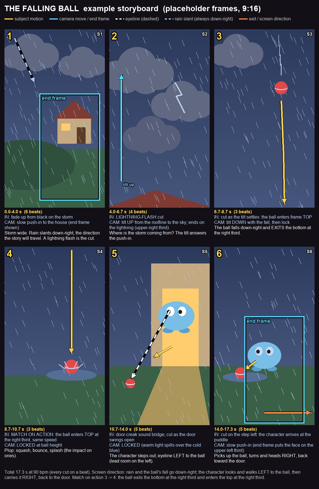

# Storyboards: plan the motion before you pay for it

A storyboard sheet answers, on one page, the questions a video model will otherwise answer for you (badly):
which way things move, where the camera goes and where it stops, who looks at what, how each shot hands over to the
next, and how long each one lasts. Draw it over the approved keyframes ([KEYFRAMES.md](KEYFRAMES.md)), get a yes on
it, and only then animate ([ROUTING.md](ROUTING.md)).



*The example in `tools/storyboard/example/`: six placeholder frames drawn in code, with motion arrows, two camera
end frames, an eyeline and per-shot timing, IN, CAM and action notes.*

---

## 1. The tools

```bash
# the annotated sheet (and the rule-of-thirds overlay sheet)
python tools/storyboard/sheet.py tools/storyboard/example/storyboard.json            # -> storyboard-sheet.jpg
python tools/storyboard/sheet.py tools/storyboard/example/storyboard.json --thirds   # + storyboard-thirds.jpg

# the rule-of-thirds check per frame (overlays + thirds.json); manual = no API, free
python tools/storyboard/thirds.py qa/thirds --storyboard storyboard.json --backend manual
python tools/storyboard/thirds.py qa/thirds --storyboard storyboard.json --backend fal --max-cost 0.20
python tools/storyboard/thirds.py qa/thirds frames/S1.png frames/S2.png --backend openai --model gpt-4.1-mini
python tools/storyboard/sheet.py storyboard.json --thirds --thirds-json qa/thirds/thirds.json

# redraw the example's placeholder frames
python tools/storyboard/example/make_frames.py
```

Only Pillow is needed. The sheet works for vertical (9:16) and wide (16:9) frames; it sizes panels from the first
frame. Fonts come from the system (Arial, DejaVu or Liberation; set `STORYBOARD_FONT` / `STORYBOARD_FONT_BOLD` to a
`.ttf` path to choose), with Pillow's built-in font as the fallback.

### storyboard.json

```json
{
  "title": "MY SHORT  storyboard v1",
  "bpm": 90,
  "columns": 3,
  "legend": {"weather": "rain slant (always down-right)"},
  "notes": "Screen direction: ... (printed under the grid, after the total running time)",
  "shots": [
    {"id": "S1", "image": "frames/S1.png", "beats": 6,
     "cut_in": "fade up from black",
     "camera": "slow push-in to the house (end frame shown)",
     "action": "Storm wide. Rain slants down-right.",
     "arrows": [{"kind": "weather", "points": [[0.10, 0.05], [0.30, 0.30]]}],
     "end_frame": {"x": 0.35, "y": 0.36, "w": 0.6},
     "composition": {"horizon_y": 0.67, "main_face": [0.69, 0.56], "secondary": [], "dead_foreground": 0.08}}
  ]
}
```

| Field | Meaning |
|---|---|
| `bpm` + `beats` | Duration per shot in beats; the sheet prints cumulative start-end seconds. Use `"seconds"` instead of `"beats"` for a shot that isn't on the grid. |
| `cut_in` | How we cut INTO this shot (match on action, flash cut, sound bridge...). Printed as `IN:`. |
| `camera` | The move, and where it ends. Printed as `CAM:`. "LOCKED" is a valid, often the best, answer. |
| `action` | One line: what happens, which way it moves. |
| `arrows` | Polylines in frame fractions (0-1 from the top-left); the head is drawn at the last point. Optional `label`. |
| `end_frame` | Where a camera move ends, as a box `x, y, w` in frame fractions; `h` defaults to `w`, which keeps the frame's aspect. |
| `composition` | Optional numbers for the thirds check with no API (`--backend manual`). |

| Arrow `kind` | Drawn as | Use for |
|---|---|---|
| `act` | yellow, solid | subject motion: a fall, a step, a reach |
| `cam` | cyan, solid (+ the cyan end-frame box) | camera move: tilt, pan, push-in, follow |
| `eye` | white, dashed | eyeline: from the eyes to what they look at |
| `weather` | pale blue, dashed | rain, snow, wind, smoke direction (keep it constant across the scene) |
| `exit` | orange, solid | an exit or the screen direction a character leaves on |

### How an agent fills in the coordinates

Arrows are the only part of the sheet that needs eyes. Do it per frame, not from the script:

1. **Open the frame image** and find the subject: where it is now and where it goes in this shot.
2. **Write points as fractions of the frame**, `[x, y]` from the top-left: the centre of the frame is `[0.5, 0.5]`,
   the right third line is `x = 0.667`, the bottom edge is `y = 1.0`. Start an arrow on the subject (or just off it,
   so the arrow doesn't hide the face) and end it where the motion ends. Use 3+ points for a curve or an arc.
3. **Exits and entrances use the edge:** an exit ends at `y = 0.98` (bottom) or `x = 0.97` (right); the next shot's
   entrance starts at the matching edge and the same third (`x = 0.667` out, `x = 0.667` in).
4. **Eyelines** start between the eyes and end on the thing looked at.
5. **End frames:** place the box so the subject lands on a third intersection *of the box*. For a subject at
   `(sx, sy)` and a box width `w`, the upper-left intersection is `x = sx - w/3, y = sy - w/3`.
6. **Render, then look at the sheet.** An arrow that crosses a face, points the wrong way or ends off-frame is a fix
   in the JSON, not in your head. Re-render until the sheet reads at a glance.

---

## 2. The rule-of-thirds check

`thirds.py` gets four numbers per frame (as fractions): the horizon or ground line, the main subject's face (between
the eyes), any secondary subjects, and how much of the bottom is empty ground. Code then flags:

| Flag | Default threshold | Fix |
|---|---|---|
| Horizon mid-frame | horizon in 0.42-0.58 (`--mid`) | put it on a third: low for sky and weather, high for ground action |
| Main subject off thirds | > 0.10 from every third line (`--line-tol`) or > 0.15 from every intersection (`--int-tol`) | re-frame, or plan a camera move whose end frame lands it there |
| Dead foreground | > 25% of the height is empty ground at the bottom (`--dead-max`) | raise the horizon, move the subject down, or put something there |

Backends:
- `manual`: no API at all. Read the numbers from each shot's `composition` block, or from `--manual file.json`
  (`{"S1": {...}}`). Place them by eye; it is a five-second job per frame and makes the check free.
- `fal`: any vision model on fal's OpenRouter vision endpoint (`FAL_KEY`; default `google/gemini-3.5-flash`).
- `openai`: any OpenAI-compatible endpoint with image input (`THIRDS_OPENAI_BASE`, `THIRDS_OPENAI_KEY`).

Paid runs log to the spend ledger, stop at `--max-cost`, and stop on a 401/402/403 instead of falling back.

**Read the flags, don't obey them.** The start frame of a push-in is often wider than the rule wants; that is fine
when the shot's end frame lands the subject on an intersection (the example's shot 6 flags for exactly this reason).
Water, a road or a puddle the action happens in is not "dead" foreground. Write down why a flag stays.

---

## 3. Cinematography principles

What the sheet is for. Learned on short cartoon films, but none of it is cartoon-specific.

### Composition

- **Rule of thirds.** The horizon sits on a third, never across the middle. Faces (the eyes) sit on a third
  intersection. Avoid big areas of dead foreground.
- **Lead room.** Leave space in front of a face, in the direction it looks or moves. A character looking left sits
  on the right third.
- **Vary shot scale as a sequence.** Wide to establish, medium for the action, close for the reaction. Three wides
  in a row read as one shot that keeps jumping.

### Direction and continuity

- **Screen direction is story direction.** Pick a direction for the journey (rain, a fall, a walk) and keep it. A
  character going out goes left; coming back goes right.
- **The 180-degree line.** Keep the camera on one side of the action, so a character moving right keeps moving right
  across the cut. When a new set would force the direction to flip (outside to inside), **mirror the plate**, not the
  character: a flipped character swaps sides of its own design.
- **Eyelines.** When two shots show a looker and the looked-at, the eyeline arrow in shot A must point where the
  subject sits in shot B.

### Cuts

- **Cut on action.** Cut in the middle of a movement, not after it ends; the motion carries the eye across the cut.
- **Match on action.** An object leaves the bottom of the frame on the right third and enters the next shot from the
  top on the right third, at the same speed.
- **Transitions that tell the story.** A lightning flash *is* the cut. Cold blue outside becomes warm amber inside at
  the door. A match cut from a fire's glow to a lit window seen from outside says "and the storm goes on without
  them". A sound bridge (a creak that starts before the door is seen) pulls the viewer into the next shot.

### Camera

- **Motivated moves.** Every move answers a question: push in to say "this matters", tilt up to say "where is it
  coming from?", follow a fall down. A move without a reason reads as drift.
- **Plan the end frame.** Every move ends on a frame you have drawn (the cyan box), composed by the rule of thirds,
  and the next shot picks up from it (a tilt up to the sky; cut; the thing falls out of that sky).
- **Lock it when the action carries the shot.** A locked camera on a good composition beats a move on a bad one.

### Rhythm

- **Cut on beats.** Pick a tempo and land every cut on a beat; the sheet does the arithmetic.
- **Hold for mood, cut fast for action.** Long holds (5-6 beats) for weather, arrival and endings; quick cuts (2-3
  beats) for a fall, an impact, a surprise; about 4 beats for acting.

### The edit plan

Write a table before you animate. Each row is a promise the next shot has to keep:

| # | Shot | Duration | Motion in | Motion out | Cut type | Camera |
|---|---|---|---|---|---|---|
| 1 | Storm wide | 0.0-4.0 s (6 beats) | rain slanting down-right | lightning flash whites out the frame | fade up from black | slow push-in, ends on the house |
| 2 | The sky | 4.0-6.7 s (4) | tilt up from the roofline | tilt settles; the ball is about to enter top | flash cut | tilt up, ends on the lightning (upper-right third) |
| 3 | The fall | 6.7-8.7 s (3) | ball enters top | ball exits bottom at the right third | cut as the tilt settles | tilt down with the fall, then lock |
| 4 | The landing | 8.7-10.7 s (3) | ball enters top at the right third, same speed | ball settles; a creak starts | match on action | locked at ball height |

Then list the rules it follows under the table: screen direction, the match cuts, the linked camera moves, eyelines,
the transitions, the rhythm. A reviewer checks the cut against that list.

### Process

- **Stills first.** Make every shot as a still, put them on the sheet with the arrows, and get a yes on the sheet
  before any video is generated. Changing an arrow is free; re-rendering a shot is not.
- **Explore cheap, finish expensive.** Rough the frames and the blocking on a cheap, fast image model (many takes,
  thirds check, arrows), then render the approved final keyframes on the expensive one, with the same composition.
- **Check the sheet, then the cut.** After animating, compare the cut to the sheet: did each move end on its end
  frame, does every exit match its entrance, did the screen direction hold? ([QA.md](QA.md)).
